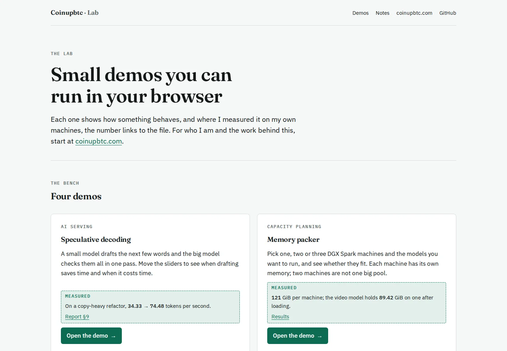

# coinupbtc.xyz · The Lab



Source for **[coinupbtc.xyz](https://coinupbtc.xyz/)**: small demos you can run in the browser, each tied to something I measured on two NVIDIA DGX Spark machines. The hiring homepage is **[coinupbtc.com](https://coinupbtc.com/)** ([repo](https://github.com/Coinupbtc/Coinupbtc.github.io)).

## The demos

| | Page | What it shows |
|---|---|---|
| 01 | [`demos/spec-decode.html`](demos/spec-decode.html) | Speculative decoding: a small model drafts `k` tokens, the big model checks them in one pass. Speedup against draft length, so the peak and the decline after it are visible. |
| 02 | [`demos/memory-pack.html`](demos/memory-pack.html) | Pick 1, 2 or 3 Sparks and the models to run, and watch each 121 GB machine fill. Resident sizes come from my machines. |
| 03 | [`demos/render-cost.html`](demos/render-cost.html) | A render bug where selecting one row rebuilt every row, next to the fix, **timed in your browser**. |
| 04 | [`demos/moire.html`](demos/moire.html) | Two grids that almost agree. A 1% spacing change moves the interference pattern a long way, the principle a vernier scale uses. |

Two older demos are still online but off the main page: the [fee-band router](https://coinupbtc.xyz/demos/mempool.html) and [Host](https://coinupbtc.xyz/demos/host/).

Notes: [A 90-second stall, fixed](notes/prefill-interleave.html), a prefill bug I reported and patched upstream.

## Rules these pages follow

- **Small.** One HTML file per demo. No backend, framework, build step or bundler.
- **No tracking.** No analytics, cookies or runtime network calls beyond the web fonts.
- **Measured, not asserted.** Demo 03 times your own machine and prints what it finds. Demo 02 uses resident sizes from my machines. Where a page simplifies, it says what it leaves out.
- **Motion is optional.** Animations respect `prefers-reduced-motion`.
- **One look with coinupbtc.com.** `assets/lab.css` holds the shared colors and fonts, light and dark.

## Notes worth keeping

**Demo 03: timer resolution is a trap.** The fast path runs far under the clock's resolution, and browsers coarsen `performance.now()` to resist fingerprinting (Brave quantizes to 100 µs). Timing a single call can land inside one tick and read `0.00`, which would make the headline ratio a fabrication. The page grows the batch until the total clears the timer floor by a wide margin, then divides. It caps the slow path at a 4-second budget so a 2,048-row run cannot lock the tab.

## Run it locally

```bash
git clone https://github.com/Coinupbtc/coinupbtc-xyz.git
cd coinupbtc-xyz && ./setup.sh
```

Or open `index.html` directly; the pages work from `file://` except Host, which needs the folder served.

Share card: `scripts/og-card.html`, rendered to `assets/og-image.png` by `scripts/export-og.sh`.

## Contact

Pseudonymous: no real name, employer, phone or street address.
[GitHub](https://github.com/Coinupbtc) · [X @coinupbtc](https://x.com/coinupbtc) · coinupbtc@gmail.com
